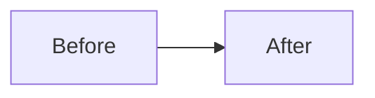

## Summary

<!-- Two or three sentences: what changes for the user or the code, and why. Required. -->

<!-- Optional: a mermaid diagram when the change moves data, control flow or state between parts. Delete if it doesn't help.

-->

## Changes

-

## Testing

<!-- Commands you ran and their result. -->

## Limitations

<!-- Known gaps, or "None". -->

Closes #
